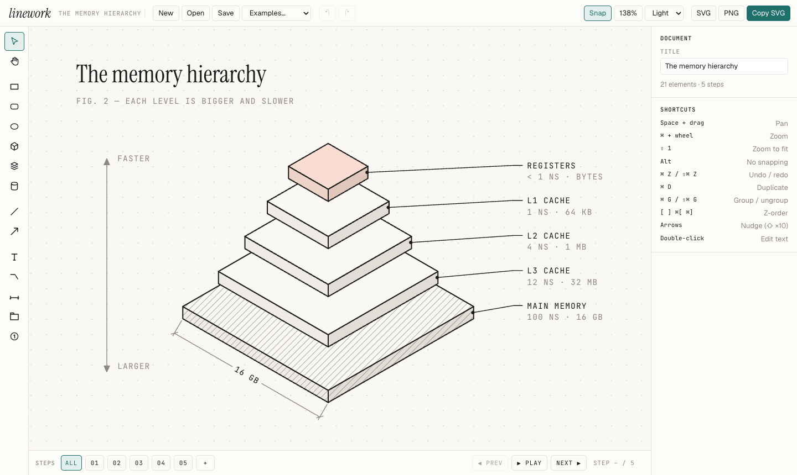

# linework

**Editor:** <https://maskmanlucifer.github.io/linework/editor/> · **About:** <https://maskmanlucifer.github.io/linework/>



A diagram tool for calm technical explainer drawings: thin even strokes, warm paper, one accent color, mono uppercase labels with leader lines, isometric boxes and stacks, dimension lines, and step-by-step animated states.

| Path                 | What                                                                          |
| -------------------- | ----------------------------------------------------------------------------- |
| `packages/linework`  | `@maskmanlucifer/linework`: JSON model, SVG renderer, React `Diagram` and `DiagramPlayer`. See its [README](packages/linework/README.md), including **Install**. |
| `apps/editor`        | Vite + React editor that uses the library.                                    |
| `site/`              | The about page. `.github/workflows/pages.yml` deploys it with the editor.     |

## Run

Requires Node 24 and pnpm 12.

```sh
pnpm install     # also builds the library (prepare script)
pnpm dev         # editor on http://localhost:5173
pnpm build       # build everything
pnpm test        # run all tests
```

## Editor

- Canvas: dotted grid, pan (Space + drag, wheel, hand tool), zoom (⌘/Ctrl + wheel or pinch), snap to a 10 px grid (hold Alt to bypass), ⇧1 zoom to fit.
- Tools: select (V), hand (H), rectangle (R), rounded rectangle (U), ellipse (O), isometric box (B), isometric stack (S), cylinder (C), line (L), arrow (A), text (T), callout (N, drag from the target to the label), dimension (D), frame (F), numbered badge (M).
- Editing: multi-select (Shift-click, marquee), move, resize and endpoint handles, z-order (`[` `]`, ⌘`[` ⌘`]`), duplicate (⌘D), delete, align, group (⌘G / ⇧⌘G), undo/redo (⌘Z / ⇧⌘Z), arrow-key nudge.
- Steps panel: add and remove steps, captions, set per element "appear here", "last here", "only here", "always" and "highlight", preview with PREV / PLAY / NEXT.
- File: autosave to localStorage, save/open JSON, export SVG and PNG (current step and theme), copy SVG.
- Examples: hash table lookup, memory hierarchy (isometric), request flow.

## License

MIT. Built by [Maskman Lucifer](https://github.com/maskmanlucifer).
